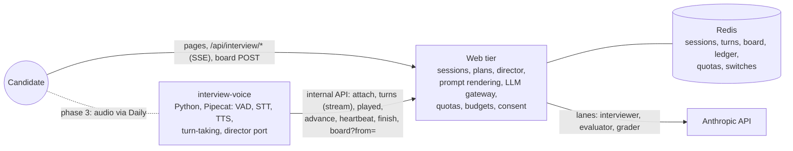

# Mock interview program (P3-11)

The design for Arrowbox's mock front end system design interview: what it is, how it is built,
what it costs, and how it grows from a text beta to voice. It answers GAP3-2 (no architecture),
GAP3-3 (cost), GAP3-4 (privacy and consent) and GAP3-5 (granularity) in the
production-readiness plan (lego: docs/production-readiness-plan.md).

| Document | What |
|---|---|
| This page | Scope, phases, architecture, content, prompts, rollout, open questions |
| [ADR 0002](adr/0002-interview-per-system.md) | The unit of an interview is the system |
| [ADR 0003](adr/0003-section-driven-interviews.md) | Sections drive the interview; plans derive from the topics; the web tier owns the session |
| [ADR 0004](adr/0004-interview-whiteboard.md) | The whiteboard is text to the interviewer and evidence only in part |
| [ADR 0005](adr/0005-interview-voice.md) | Voice: the web owns the session, a Pipecat service owns the audio, leases fence them |
| [cost-model.md](cost-model.md) | Cost per session and per month, and how every quota follows from it |
| [privacy.md](privacy.md) | What is collected, consent, retention, deletion, Permissions-Policy |
| [coach-mode.md](coach-mode.md) | Proposal: the AI drives a lesson topic by topic, draws and answers doubts, on the same plans and the same voice service |

## Status

**First slice, done (behind the flag, off by default):**

- The unit decided: one interview per system, at `/systems/<system>/interview` (ADR 0002); sections
  as the unit of coverage, with topic and section drills, and plans derived from the topics (ADR
  0003, `npm run content:derive`).
- Interview plans as content: `content/interviews/<system>.yaml`, schema, JSON Schema, linter and
  the example plan for Instagram (`content-kit/src/interview.ts`, `src/lint/interview.ts`).
- A text-only prototype: the landing page from the plan, consent, the room (stages, clock,
  streamed replies, next stage, end), written feedback per stage and dimension, delete. Server in
  `web/src/lib/server/interview/`, routes in `web/src/pages/api/interview/`.
- Through the LLM gateway with its own lane and quotas (sessions per month, messages, dollars and
  minutes per session, daily budget, a pause switch).
- Tests: unit and route tests with a stubbed Anthropic client, e2e for both builds against the
  mocked API.
- The director in the text room (Phase 0, wave 2): every system with a design article gets a
  derived plan in the snapshot (`interviews[]`, with the hand-written plan merged in where one
  exists); the room runs the decision table in `web/src/lib/server/interview/director.ts` on each
  candidate turn and idle rung (ask, drill, probe once, rephrase, hint, hint, skip, section bridge,
  stage advance, wrap-up); the model reads the decision as a `<director>` element and the service
  performs the move. Stage notes travel in the stage marker (cached with the transcript); idle
  rungs 20/35/60/120 s via `POST {action: 'idle', rung}`; a "Hold on, I'm thinking" button.
- The evidence ledger and the item-verdict grader (Phase 0, wave 3): after each reply a Haiku
  call (`evaluator.ts`, lane `interview-evaluator`, `INTERVIEW_EVALUATOR*`) tags the candidate's
  turn against the stage's items into `interview:ledger:<id>`; quotes are checked against the
  candidate's own words (never the interviewer's), later evidence wins, and the aggregate is the
  live signal (`interview:signal:<id>`, monotonic) the director reads one turn behind. The final
  pass asks the grader for item verdicts with quotes; ratings follow fixed rules in `grading.ts`
  (strong at 90% core coverage and nothing wrong, solid at 70% with at most one wrong, developing
  at 40%, 1 for any evidence, 0 for a section never reached; a stage is the item-weighted mean of
  its sections). Feedback gains sections, weak areas, not covered and the item verdicts; the report
  links each section to its heading. Harness in `web/eval/interview/` (below).

**With `PUBLIC_INTERVIEW_ENABLED` unset (the default) the public site is unchanged:** no interview
page is built, `/api/interview*` answers 404, the reader shows no interview card and its props are
byte-for-byte what they were. The only trace is an unreferenced script and stylesheet in
`dist/client/_astro/` that no page loads (Astro compiles a route's island even when the route has no
pages).

- The prose pass (Phase 0, wave 4): `npm run content:derive:prose` writes
  `content/_derived/<system>/<topic>.<section>.<hash>.json` (one Sonnet call per section over the
  running text, quotes verified), the deriver merges the items as `source: prose`, the linter
  fails on a stale hash. Run on customer-support-agent: 12 files, 55 items, about $0.14.

- The whiteboard in the room (phase 2b, 2026-10-23): the canvas and outline, the board's text in
  the turns, the matcher and vision fallbacks, the grader's images (ADR 0004).
- Voice (phase 3, 2026-10-23, on staging): the voice room (`VoiceRoom.tsx`, Pipecat's browser
  client over Daily; `voice-call.ts` plays the interviewer's audio track through a hidden audio
  element, since the transport plays nothing itself), the web's voice side (`voice.ts`: Pro-only start, the month's voice sessions
  and minutes, Daily rooms and tokens, fenced leases, parking, the speech charges) and the
  `interview-voice` Python service (one Pipecat pipeline per session: Deepgram, Cartesia, Silero
  VAD and smart-turn, the idle rungs, heartbeats). Design and operation under "Voice" below
  (ADR 0005).

**Not done yet:** the prose pass on the other systems (adopt it system by system; the linter only
nags systems that have a file), the human-rater kappa study before numeric ratings are shown, the
legal review (privacy.md, now with the voice consent), and the voice beta's human gates: the
vendor keys and a staging deploy, a load test of one voice task to size
`VOICE_MAX_SESSIONS_PER_TASK`, and the voice picked for the interviewer.
- Early access (phase 4 of the table, 2026-10-23): the allowlist and the system list, the cost
  report and the kappa tool are built ("Rollout" below); the production flip itself waits on the
  gates there (reviewed topics, secrets, counsel).

## Phases

| Phase | What ships | Gate to start it |
|---|---|---|
| 1. Hidden | Flag off, waitlist card (P0-20). Done. | — |
| 2a. Text beta (this prototype) | Text chat with an AI interviewer, per-stage written feedback, for signed-in readers who opt in; systems with a reviewed plan only | Legal review of the consent text and the privacy policy section; a reviewed plan; the grader eval passing (below); production spend limits set from cost-model.md |
| 2b. Text + whiteboard beta | A canvas the candidate draws on and the interviewer reads (and, since phase 4, draws on). Built: board store, serialiser, matcher, evidence, grader images, the room's canvas and outline, headers and flag ("Whiteboard" below); behind `PUBLIC_INTERVIEW_BOARD_ENABLED` until 2a has run a month | 2a running for a month with the cost within the model |
| 3. Voice | Speech in and out, with the whiteboard. Built: the voice room, the web's voice side and the `interview-voice` service ("Voice" below); on staging, behind `PUBLIC_INTERVIEW_VOICE_ENABLED`; Pro only, five 45-minute sessions a month | 2b stable; the vendors' keys and DPAs (Daily, Deepgram, Cartesia); recording consent reviewed (privacy.md); a load test of one voice task |
| 4. Early access | A production build for an allowlist on one system. Built: the allowlist (`INTERVIEW_ALLOWLIST` plus `interview-switch.mjs allow`, staff always in; others see an early-access note), the system list (`PUBLIC_INTERVIEW_SYSTEMS`), the cost re-measurement (`npm run interview:cost`) and the kappa study's tool (`npm run eval:kappa`) ("Rollout" below) | The three customer-support-agent topics `reviewed`; the production secrets filled; two weeks of cost within 20% of the model; kappa ≥ 0.6 before numeric ratings are shown |
| 5. Generalise (agentic track) | Drills in the product ("Drills" below): every agentic-track topic and section as a short interview, concept systems with a drill-only page, drill links in the reader's rail; the eval's concept-drill goldens; the interviewer drawing on the board ("Whiteboard" below); voice top-ups are the next wave. Other tracks stay on the whole-system interview until their prose is refined (tracks.yaml `interviewDrills`). | Phase 4 open to all Pro; a track's prose reviewed before its flag is turned on |

Each phase has its own flag, so voice can be off while text runs.

## Target architecture: the web tier owns the session

**Superseded on 2026-10-22 by [ADR 0003](adr/0003-section-driven-interviews.md).** The earlier
plan here (a separate interview service with its own Postgres schema, a retention job of its own
and sticky WebSocket routing) is not built. The interview is a stateful 45-minute session, but
everything durable about it is small and private: a few hundred turns, a board, an evidence ledger,
one feedback document. That fits the web tier and Redis the prototype already uses. What does not
fit the web tier is the audio loop, and only that moves out.



- **Web tier** (`web/src/lib/server/interview/`). Owns sessions: start, the stage machine and its
  clock, turns, closing, deletion, consent, quotas and the dollar caps. It is the **only renderer
  of Anthropic requests** (`prompt.ts`) and the only writer of durable state (`sessions.ts`). The
  director (a decision table, no model tools) decides per candidate turn whether to probe, move to
  the next item or section, hint, or advance, and the interviewer reads its decision as a
  `<director>` element. The evaluator runs per turn as a serialized job under a short lock and
  appends an evidence ledger keyed by turn; the final grade is one Opus pass that produces
  item-level verdicts with quotes, from which section and stage ratings are computed by code.
- **Storage.** Live and durable state in Redis under the session's keys with the retention TTL,
  as the prototype does. No interview schema in Postgres and no Strapi writes: the CMS stays a
  content and accounts store.
- **LLM gateway.** Shared code (`web/src/lib/server/llm-gateway.ts`), used through lanes with their
  own model, token cap, effort, output format and allowance; the kill switch, the account-wide
  daily budget and the concurrency limit stay common. The voice lane gets an explicit `thinking`
  setting with a per-model allow table.
- **Plans.** Derived from the content snapshot at build time (ADR 0003, below): every instance
  serves the same plan version, and sessions record its hash. A hand-written plan still wins where
  it exists.
- **Voice (phase 3).** A separate ECS service, `interview-voice` (Python, Pipecat), owns only the
  audio loop: Daily transport, Deepgram speech-to-text, Cartesia text-to-speech, VAD and turn
  taking, a port of the director table. It holds no prompt text and no Redis connection: it
  attaches to a session under a fenced lease (`Session.voice = {epoch, seq}`; a stale epoch is
  refused with 409), posts each candidate turn to the web tier, which stores it and streams the
  interviewer's reply back from the same `replyRequest()` the text room uses, and reports what was
  actually played so a barged-in reply is truncated in the transcript. The pipeline can be rebuilt
  from `Session.turns` on any task, so a lost task is a park, not a lost session.

### A session

```mermaid
sequenceDiagram
  autonumber
  participant C as Candidate (room)
  participant S as Web tier
  participant R as Redis
  participant E as Evaluator job
  participant A as Anthropic API
  C->>S: start {system or topic or section, consent version}
  S->>R: switch, daily budget, active session?, month quota +1
  S->>R: session {problem + stage 1 opener}, consent, TTL
  S-->>C: session (no LLM call: the opener is in the plan)
  C->>S: reply {text} (Accept: text/event-stream)
  S->>R: owner, open (time, messages, dollars), lock
  S->>S: director: next item / probe / hint / advance, from the ledger's signal (one turn behind)
  S->>A: interviewer lane: plan (cached) + transcript (cached) + new message + <director>, streamed
  A-->>S: text deltas
  S-->>C: event: delta
  S->>R: + cost, + candidate turn (meta.section) + reply turn; unlock
  S-->>E: enqueue tagger(turn n) under the session's eval lock
  E->>A: evaluator lane (Haiku): utterance kind, evidence per item
  E->>R: ledger[turn n]; signal if newer
  C->>S: advance {from} (or the director advances on time-up)
  S->>R: next stage: marker with its items + opener (no LLM call)
  C->>S: finish
  S->>A: grader lane (Opus): item verdicts with quotes, JSON schema
  S->>R: feedback (per section, stage and dimension), finished
  S-->>C: session with feedback
```

The session's state machine is unchanged from the prototype: `active` (stage 1..n, each with its
start time) until the candidate ends it; it stops taking messages when it passes its planned length
plus `INTERVIEW_OVERTIME_MINUTES`, its message cap or its dollar cap (`closed: time | turns |
budget`), and the feedback can still run then, up to three billed attempts; `finished` after the
feedback (or with a note when there was nothing to grade, the grader's reply didn't parse, or three
attempts timed out or were stopped). Moving on is the candidate's decision or the clock's, never
silence: the director never advances on a quiet candidate; it nudges, then hints, and the only
automatic advance is time-up. At most one interviewer call runs per session at a time (a lock
across instances) plus one evaluator call; one session is active per reader. Every call that may
have been billed is charged to the session's dollar cap, including a reply the candidate stops or
that times out, at the gateway's conservative estimate.


## Content: interview plans

**Derived from the topics (ADR 0003).** Every system with a design article has a plan without an
author writing one: `derivePlans()` in `content-kit/src/interview-derive.ts` walks the `sd.section`
blocks of the system's topics, classifies each section into a stage kind (title first, blocks as a
tie-break, `deep-dive` by default), merges adjacent sections of a kind into stages of one or two
sections, and mines what the sections carry into **coverage items**: checklist entries,
requirement-table rows, a collapsed "names the parts" and "explains the flow" item per diagram,
one flow item per numbered note of a sequence diagram, choice lists and decisions with the options
not taken as wrong signals, state-machine transitions, failure modes, estimates, the section's
`summary` and first `intro` sentences, the `tutorBrief` sentences that name a section, an agentic
topic's tool approval rules and error behaviours, and the answers of a "How it's asked" section
with its questions as probes. Clarifying Q&A, glossary tables and out-of-scope lists become
`pmFacts`, what the interviewer answers from. At most five core items per stage; minutes follow
the items. Scopes: the **system** (45 minutes, the headline card), a **topic** (about 13) and a
**section** (about 7) are drills of the same plan. A system whose numbered sections continue across
files (customer-support-agent) is one article; one of independent topics (instagram, url-shortener)
takes its lead topic in system scope, and every topic is a drill. Concept articles (ML, genai,
data: "The idea", "How it works", "In practice", "Trade-offs") get four-stage drills and no system
interview.

```
npm run content:derive -- customer-support-agent            # stages, kinds, minutes, core counts
npm run content:derive -- customer-support-agent --items    # every item with its source
npm run content:derive -- booking-system/availability-search#correctness
npm run content:derive -- url-shortener --json              # what the web tier reads
```

Authors improve an interview by improving the article: a `summary:` line on a section, a checklist,
a decision block. Three optional fields on `sd.section` fix a section in minutes: `interviewKind`
(the stage kind, when the title would be misread), `interviewProbes` (questions that become core
items) and `interviewDrop` (item numbers or block keys to leave out). The linter derives every
system's plan: `derived-plan` (error) when the result breaks its schema, `derived-plan-sanity`
(warning) for a stage with nothing to grade or stages that do not add up to the interview length.
A derived plan is `reviewed` only when every source topic is, so the reviewed-only build serves it
only from reviewed topics (the same `published()` rule as a hand-written plan); its version is the
hash of its sources.

**The prose pass (`content/_derived/`).** What a section's running text says that no typed block
does is extracted once by a model and committed, never derived at build time:

```sh
npm run content:derive:prose -- customer-support-agent --dry-run   # which sections need a pass
npm run content:derive:prose -- customer-support-agent --max-usd 1 # one Sonnet call per section
```

`web/scripts/content-derive-prose.ts` takes every section with at least 400 characters of rich text
or subsection intros and no file for its current hash, shows the model the section's text and the
items the typed blocks already gave, and asks for up to six more (text, probe, wrong signals, the
sentence quoted). An item whose quote is not in the text is dropped before the file is written to
`content/_derived/<system>/<topic>.<section>.<hash>.json` (`interview-prose.ts`: `proseOf`,
`proseHash`, `verifyProseItems`). The deriver merges a file only while its hash matches the section's
text, skips items a deterministic item already says (word overlap >= 0.6), and tags the rest
`source: prose` (hard rules core, the rest supporting). The stage's item list (what the evaluator,
the grader and the ratings see) holds the core items and up to eight supporting ones, taken in
turns from each of the stage's sections, so a section rich in prose does not push its neighbour
off the list. The linter fails on a stale file
(`derived-prose-stale`: the section changed, so run the pass again and commit) and, in a system
the pass has been run on, warns on a section without one (`derived-prose-missing`). The script calls
the Anthropic SDK directly with its own spend cap (`--max-usd`, default 2) because the gateway is
bound to the Astro runtime; it reads `ANTHROPIC_API_KEY` from the environment or `web/.env`.

**Hand-written plans stay primary where they exist.** `content/interviews/<system>.yaml`, validated
by `interviewFile` in `content-kit/src/interview.ts` and linted with the catalog:

| Field | Seen by | What |
|---|---|---|
| `title`, `summary`, `prompt` | candidate | The landing page's title and lede; the problem the interviewer states first |
| `readFirst`, `checklist` | candidate | Topics to read first (linked on the landing page) and preparation items |
| `dimensions[]` | candidate | What the feedback rates (key, title, description) |
| `stages[].key, kind, title, minutes, goal` | candidate | The timeline, the step list, the room's stage bar and goal |
| `stages[].opener` | candidate | What the interviewer says to open the stage (shown as its first message) |
| `stages[].brief, followUps, signals, redFlags` | **interviewer and grader only** | How to run the stage, what to probe, what a strong and a weak answer look like |
| `stages[].topics, assesses` | server | Topics whose tutor briefs ground the stage; the dimensions it gives evidence for |
| `stages[].sections` | server | Section keys the stage covers: the stage replaces the matching derived stage and its `signals` become the core items (ADR 0003). Absent on every stage, the plan is used whole, as before |
| `feedbackMinutes`, `graderBrief` | server | Minutes kept for feedback; how strictly to grade |
| `reviewStatus`, `author`, `reviewer`, ... | editorial | The same gate as topics |

Private fields never reach a page: pages get a projection (`toInterviewPage` in
`web/src/lib/interview.node.ts`, tested), and `npm --prefix web run content:check-dist` fails a build
whose browser files contain a plan's private notes, as it does for tutor briefs. The linter checks
that `readFirst` and each stage's `topics` are topics of the system (a topic whose file fails
validation is not blamed on the plan), that every stage assesses declared dimensions and every
dimension is assessed, the session length (20-60 minutes), unique keys, and the editorial gate. A
stage's `key` is stable: sessions and feedback refer to it.

Plans are content-as-code (ADR 0001): written in a pull request, reviewed by a subject expert,
published by the build. They are not mirrored to Strapi because nothing reads them from there. A
system that wants a better interview than its derived one writes a plan with `sections` on the
stages it wants to shape, not a whole new plan.


## Drills

A drill is the same interview on a smaller unit (ADR 0003): one topic, as its own short plan of
two to five stages (about 13 minutes), or one section, as a one-stage plan (about 7 minutes). The
plans are the ones `content:derive <system>/<topic>[#<section>]` prints, built into the snapshot
as `drills[]` (one entry per topic with content and one per section, each with its hash and its
topic's review status) for the systems of a track whose `tracks.yaml` entry has
`interviewDrills: true`. Only the agentic track has it: the other tracks' prose is still being
refined, and a flag per track keeps the snapshot small (about 9 MB for the agentic track's 30
systems, 81 topic drills and 394 section drills) until a track is ready.

- **Pages.** A drill lives on its system's interview page with the scope in the query:
  `/systems/<system>/interview?topic=<slug>[&section=<key>]`. The page is prerendered once per
  system; the island reads the query and fetches the drill's projection with the overview
  (`GET /api/interview?system=…&topic=…&section=…` answers `page`). The system's page lists its
  drills ("Shorter drills"); a concept system, which has no whole-product plan, gets a page of
  drills only (`InterviewPage.full: false`). A topic page's rail offers the topic's drill under the
  interview card and the current section's drill on its row (`topicDrillLinks`).
- **Sessions.** `Session.scope` is `{topic, section}` or absent. `getPlan(system, scope)`
  resolves the drill; the running-session check, resume and the overview are per scope, so a
  reader may have one session at a time, whatever its scope. `POST /api/interview {system, topic,
  section?, consent[, mode: 'voice']}` starts one.
- **Quota.** Drills have their own allowance, `INTERVIEW_MONTHLY_DRILLS` (30 a month, text or
  voice); a voice drill also counts its minutes against the voice minutes, not a voice session.
  The status carries `drillLimit` and `drillsRemaining`.
- **Eval.** `planFor(system, scope)` in the harness derives the drill the same way; the goldens
  include a concept drill (what-is-an-agent, "Agents vs workflows") strong and weak.

## Prompts, grounding and grading

- **Interviewer** (`prompt.ts`, `interviewerSystem`): the rules (one question at a time, probe, no
  lecturing, a hint only after being stuck twice, under 120 words, plain text), the whole plan with
  the private notes, and the tutor briefs of the plan's topics as background. It is identical for
  every candidate on a system and cached; the transcript follows as turns, each rendered only from
  what the session saved (stage and minute included), so each reply pays full price only for the
  newest message. Candidate text is escaped inside `<candidate>` tags and declared data, not
  instructions (the same defence as Ask). The product is described as illustrative, and the
  interviewer must not claim to know how the real company builds it.
- **Grader** (`feedbackRequest`, `feedbackSchema`, `parseFeedback`): one call on the feedback
  model with structured output (a JSON schema whose stage and dimension keys are the plan's). It
  rates each stage and dimension 0-4 (0: not reached or no evidence) against the stage's signals
  and red flags, with strengths, improvements and next steps, quoting only what the candidate said.
  The reply is validated again with zod; anything off-plan is dropped, anything missing is rated 0,
  and an unparseable reply leaves the transcript with a note instead of feedback.
- **Eval** (`web/eval/interview/`, `npm run eval:interview`): golden transcripts on the
  customer-support-agent plan (strong, weak, mixed, stuck-then-recovers, confidently wrong, the
  interviewer states the answer, the interviewer names the subject, injection, declined, last-stage
  time-up, a mid-sentence "let's move on") with reviewer-labelled tags, item statuses, director
  rows and section ratings. Offline, in `npm test`: the director lands on the labelled rows, the
  labelled tags aggregate to the labelled statuses, interviewer words are never credited, ratings
  match. Live (`INTERVIEW_EVAL_MODE=live`, a spend cap; `INTERVIEW_EVAL_GRADER=none` runs the
  evaluator alone for about a cent): the real evaluator and grader against the same labels; gates
  are item precision and recall >= 0.85, wrong false-positive rate <= 5%, zero credits in the
  hinted case, section rating MAE <= 0.5. Labels name core items by number and supporting items by
  a substring of their text (their numbers move when the prose pass runs again); an `optional`
  label is an alternate the reviewer accepts (a hit when given, never a miss), which is how the
  long flow answer is labelled for the supporting items it also covers; labels in one `group`
  state one fact through near-duplicate items (the sequence diagram and the summary that restates
  it) and are recalled once when any of them is given. The report lists every turn's misses,
  extras and dropped tags. Run on 2026-10-23 with Haiku 5.5 and Opus 5: precision 0.97-1.00 and
  recall 0.95 across three evaluator runs, no wrong false positives, no hinted credit, all 22
  section ratings exact (MAE 0.00), no unparsed grader reply, $0.92 for the full run. Two things that
  run found: the evaluator's 1000-token cap cut off the tags on the longest answers (thinking
  counts against it; the default is now 3000 and both parsers read the JSON object out of a reply
  with text around it), and partial tags needed their own lower confidence floor (0.3; covered and
  wrong keep 0.55). It decides the evaluator and grader models; the weighted-kappa study against
  human raters is still to run.

## Cost and quotas

Summary of [cost-model.md](cost-model.md): a typical 20-message session is about **$0.18** (Sonnet 5
turns with the prefix cached, one Opus 5 feedback call), the heaviest the caps allow about $0.78,
about six Ask questions and 26 respectively. At 15% of 20,000 monthly readers doing two sessions
that is about $1,080 a month. The quotas: 3 sessions per reader per month, 60 messages and $1.50 per
session, the planned length plus 15 minutes, one paid call at a time per session, a daily interview
budget ($10 for the beta, about $55-60 at the expected production level) inside the account-wide
Ask breaker, and a pause switch (`web/scripts/interview-switch.mjs`). All of it is in the shared
store and fails closed. Plans (free, paid) plug in at `planOf` in the gateway (P3-8).

**Voice quota rule (owner decision, 2026-10-22; ADR 0003).** Voice interviews are **Pro only**: five
45-minute sessions a month (`INTERVIEW_VOICE_MONTHLY_SESSIONS`), counted at start and given back if
the start fails, with the planned minutes reserved from `INTERVIEW_VOICE_MONTHLY_MINUTES` (225) and
trued up from usage ticks, plus purchased **top-up sessions** consumed after the monthly five. A
voice session has its own dollar cap (`INTERVIEW_VOICE_SESSION_BUDGET_USD`, 3.00) and a daily voice
budget inside the interview and Ask budgets. Free readers see voice as a Pro feature and keep the
text interview with the quotas above.

**Top-ups** (phase 4): `interview:voice:topups:<reader>` holds a reader's purchased sessions
(`sessions.ts`: `voiceTopups`, `grantVoiceTopups`, `takeVoiceTopup`; kept a year from the last
change). A whole voice session whose start finds the month's quota spent takes one instead
(`startLocked`: the month's count is given back, `Session.topup` is set, and no monthly minutes
are reserved: the session's own caps bound it); a drill never does. The voice status carries
`topups`, the landing card says "Plus N top-up sessions" and lets the start through on them, and a
start that then fails gives the top-up back. **Granting:** there is no purchase flow yet. Razorpay
is set up for subscriptions only (`billing/razorpay.ts` has no one-off orders), and the price is an
owner decision, so until both exist the operator grants top-ups by hand:
`node scripts/interview-switch.mjs topups <readerDocumentId> add 2`. The purchase flow, when it
comes, writes the same key through the billing webhook.

## Privacy and consent

Summary of [privacy.md](privacy.md): per-session consent (versioned and stored with the session),
text only (every page keeps `Permissions-Policy: microphone=()`), transcripts kept 30 days then
deleted, deletable per session and with the account, included in the account export, messages
never logged. Voice relaxes the microphone policy on the room route only, stores no raw audio,
and needs recording consent. The consent text and the policy section need legal review first.

## Whiteboard (phase 2b)

Built on the server and in the room (ADR 0004); on in a build with `PUBLIC_INTERVIEW_BOARD_ENABLED`
(and the interview flag). The design's rules, as implemented:

- **Model:** the room posts the Excalidraw scene, compacted to what the server reads (at most 400
  elements), to `POST /api/interview/<id>/board` with the version it built on. The server keeps one
  record per session (`interview:board:<id>`, compare-and-set; a stale base is a 409
  `board_conflict` carrying the server's scene, so two tabs cannot overwrite each other) and
  serialises it into a small graph (`web/src/lib/board/serialise.ts`): boxes with labels (bound
  text, text inside, a caption within 24 px, else named by position), frames and enclosing shapes
  as containers, arrows by binding or snapped to the nearest box within 24 px (marked inferred),
  direction from the arrowheads, dashes kept, freehand strokes counted and clustered, rows by 160 px
  bands, stable short ids (n1, e1, F1) kept with the record. The response is only
  `{version, fingerprint}`; the fingerprint (over element ids and versions) lets the room skip saves
  that change nothing.
- **What the interviewer reads:** a candidate turn carries the whole board the first time
  (`<board v="3" stage="…">`, about 230 tokens for a dozen boxes) and a delta after it
  (`<board-delta>`: `+`, `-`, `~` and `moved:` lines; the whole board again when the delta would be
  longer), rendered on the server and saved in the turn's meta so the prompt is rebuilt byte for
  byte (prompt caching holds). `<board-questions>` lists what the matcher noticed as questions to
  pick from (at most one a turn; never "wrong" or "missing"). `<board-vision>` is a plain
  description of a mostly freehand or unlabelled board, from the PNG the room posts
  (`POST …/board/png?stage=current`), on the evaluator's model, once per board version and at most
  `INTERVIEW_BOARD_VISION_CALLS` a stage.
- **Matcher** (`web/src/lib/server/interview/board-match.ts`): the plan's board reference
  (`DerivedPlan.board`: the system's components once each, with `aliases`, `introducedIn` and
  `reachableOnlyVia` from the topic files, and every component diagram's edges) against the board:
  name, key, alias, token overlap, edit distance, then a synonym table; labels still unplaced go to
  one batched call on the evaluator's model, at most `INTERVIEW_BOARD_MATCH_CALLS` a stage, whose
  answers score lower. The coverage (components matched; missing among those the sections reached
  so far introduce; extra boxes; arrows matched, missing and unexpected, the ones into a guarded
  component first) stays on the server: `content:check-dist` fails if the matcher's text reaches
  `dist/client`, and the service tests check that no response carries it.
- **The interviewer draws** (phase 4; `web/src/lib/server/interview/draw.ts`): a reply may carry
  `<draw>` elements of up to four operations in all, `<box label="…"/>` and
  `<arrow from="…" to="…" label="…"/>`, naming boxes by label (or the n-id the interviewer was
  shown). The prompt allows it once a stage and only for what the candidate said in words (a box
  they named but did not draw, an arrow they described): drawing anything else would give the
  answer. The service takes the elements off the reply (the stream filter `holdDraw` keeps them out
  of the room's typing and the voice, and hands each one over as it closes with the count of words
  before it: a `draw {ops, anchor}` SSE event the room draws at once, and the voice service holds until
  those words have played, coach-mode.md phase 5), checks each operation against the board record's graph (unknown boxes
  dropped with a reason the model reads on its next turn, `TurnMeta.drawDropped`; a second drawing
  in a stage dropped, `Session.drawn`) and saves the operations on the turn (`TurnMeta.draw`, in
  the room's view of the turn). The room applies them through the board handle
  (`InterviewBoard.draw`, queued until the canvas is up, drawn by the animated pen in
  `web/src/lib/board/pen/`, vendored from drawing-board): dashed
  rust-coloured elements with `customData.author: 'interviewer'`, which the serialiser already
  marks, so the matcher's `(interviewer)` boxes are never the candidate's evidence.
- **Evidence:** a drawable item the board shows gets a `partial` ledger entry (`b<seq>`, confidence
  0.6, no quote). The director reads partial as something to ask about, never as ground covered,
  so a board alone cannot advance a stage; the candidate's words make it covered. Text snapshots of
  the board are taken as each stage ends and at the finish (at most 12) and go to the grader in
  `<boards>`, with the stages' PNGs (the room renders one as a stage ends; at most 8 a session,
  200 KB each) as images.
- **Privacy:** the board record, its snapshots and PNGs live under the session's keys and die with
  it; the PNGs go to the AI provider like the transcript (privacy.md).
- **Room** (`web/src/components/sd/InterviewBoard.tsx`): Excalidraw 0.18.1, loaded with `import()`
  when the board opens (the room imports it through a literal check of the flag, so other builds
  carry none of it; `ExcalidrawCanvas.tsx` is the only module that touches the library) with the
  export, load, save and theme actions hidden and its fonts served from this site
  (`scripts/copy-excalidraw.mjs` copies them to `public/excalidraw/` before a build, the CJK
  family left out). Saves go 1.3 s after the last change with the pointer up, at most one every
  5 s, and before the candidate's message, at a stage change and at the finish, so the interviewer
  reads the board as it stood; a 409 loads the other tab's scene; unsaved changes leave by
  `sendBeacon`. The room renders the PNGs (the server has no renderer): one as a stage ends, and
  one for the vision fallback after a save when the board is mostly freehand or unlabelled. The
  interview pages alone carry `worker-src 'self' blob:` (Excalidraw's font worker;
  `roomCsp()` in `security-headers.ts`, applied at build time to `/systems/*/interview` when the
  flag is on). Budgets in `web/.size-limit.mjs`: the editor's chunk and the font subsetter's.
  Excalidraw's "Mermaid to Excalidraw" dialog gets a stand-in (`web/src/lib/board/no-mermaid.ts`)
  instead of mermaid and its renderers, which no page otherwise ships.
- **Accessibility:** `BoardOutline`, a list of the same graph (boxes, arrows) editable from the
  keyboard: add, connect, rename, delete; the interviewer is told the candidate may describe the
  design in words. The board is never the only way to answer.
- **Eval:** two goldens draw the request flow (`web/eval/interview/goldens.ts`, `board-only` and
  `board-and-words`): the replay carries the board as the service does, and asserts partial
  evidence that never advances a stage, and words credited on top of the same board.
- **Deferred:** the interviewer drawing on the board; a CRDT only if two people ever share one.

If the canvas itself crashes (the library's own error), the board shows a notice with a **Reload the canvas** button that mounts it again on the current scene; the outline keeps working meanwhile. The canvas gets stable props and the board only sets state when the scene's fingerprint changed, because Excalidraw reports a change after every render of its own and would otherwise loop with the board (`InterviewBoard.test.tsx`).

## Voice (phase 3)

Design section 6 of the AI interviewer note; [ADR 0005](adr/0005-interview-voice.md). The web
tier keeps owning the session; a separate service owns the audio and nothing else.

```mermaid
sequenceDiagram
  participant B as Browser (VoiceRoom)
  participant W as Web (voice.ts)
  participant D as Daily
  participant V as interview-voice (Pipecat)
  B->>W: POST /api/interview {mode: voice, consent, audioOptIn}
  W->>D: create private room iv-<sid>, bot token
  W->>V: POST /sessions {sid, attach token, room, language}
  W-->>B: {session, join: {url, token}}
  V->>W: POST /api/internal/interview/<sid>/attach {token} → epoch, stage, opening line
  B->>D: join (Pipecat client, Daily transport)
  V->>D: join; speak the opener
  loop each candidate turn
    V->>W: POST …/turns {epoch, seq, text} (SSE reply)
    V->>D: speak the reply as it streams, from its first clause
    V-->>W: POST …/played {spoken} when interrupted
  end
  V->>W: POST …/heartbeat {sttSeconds, ttsChars} every 15 s → closed?
  B->>W: POST /api/interview/<sid>/voice {action: leave} (or the line drops → detach transport, parked)
```

- **Start and quota** (`startVoiceSession`): Pro (and staff) readers only, with the voice consent
  version (`VOICE_CONSENT_VERSION`); five sessions a month (`INTERVIEW_VOICE_MONTHLY_SESSIONS`)
  and the plan's minutes reserved from `INTERVIEW_VOICE_MONTHLY_MINUTES` (225), both under the
  reader's voice keys, given back if the start fails. The room checks the microphone from the
  click before the start is posted.
- **Rooms and tokens** (`daily.ts`): one private Daily room per session (`iv-<sid>`, two
  participants, no recording, expires with the session), a meeting token for the pipeline and a
  five-minute one for the candidate on every join. Daily's key is the web's only; the service
  never has it.
- **Leases** (`VoiceState`): each attach starts a new epoch; the lease is renewed by turns and
  heartbeats and stands a minute (`VOICE_LEASE_MS`). While it stands, the text room's reply,
  advance, idle and finish answer 409 `voice_live`; a pipeline with an old epoch gets 409
  `stale_epoch`; turns must arrive in sequence (`seq = lease.seq + 1`). The attach token is a
  signed, single-use, 60-second credential (`voice-token.ts`) that names the reader, the session,
  the plan hash and the consent version.
- **Parking**: a dropped line (the candidate left, a transport error, a task stopping) detaches
  with reason `transport`: the session is parked, its clock stops for up to 15 minutes
  (`PARK_MAX_MS`), and the next join credits the pause to the session's end and the stage. The
  room rejoins by itself, with backoff; after that the candidate retries by hand, or switches to
  typing.
- **The service** (`interview-voice/`, its README): FastAPI (`POST /sessions`, `DELETE
  /sessions/{sid}`, `/health`, `/ready`) over a supervisor that runs at most
  `VOICE_MAX_SESSIONS_PER_TASK` pipelines, each `DailyTransport → RTVI → Deepgram → TurnShaper →
  user aggregator (Silero VAD, smart-turn v3) → GatewayLLMService → Cartesia → DailyTransport`. The
  gateway is the "LLM" of the pipeline: it posts the turn to the web and speaks the streamed reply;
  on an interruption it reads the stream to its end (the web saves the whole exchange) and reports
  what was heard, which the web trims the saved turn to. A `UsageObserver` counts the audio seconds
  sent to Deepgram and the characters sent to Cartesia for the heartbeats; the web charges them at
  `VOICE_STT_USD_PER_MIN` and `VOICE_TTS_USD_PER_1K_CHARS` into the session's cost, the voice day
  and the interview day. SIGTERM parks every session (ECS stop timeout 120 s), so a deploy is a
  short pause, not an ended interview.
- **Silence**: the pipeline's `IdleGate` reports the rungs (20, 35, 60, 120 s after the
  interviewer's last word) to `/idle`; the director's canned lines come back and are spoken.
  Nothing is advanced on silence; "Next stage" in the room waits while the voice is on (the
  candidate says "let's move on").
- **Captions and transcript**: the room shows the candidate's interim transcription and the
  interviewer's words as they are spoken (RTVI events), and refreshes the saved transcript every
  few seconds; the saved turns (`source: 'voice'`, `interrupted`) are what the grader reads.
- **Switches and budgets**: `INTERVIEW_VOICE_ENABLED` and `interview-switch.mjs voice off` pause
  voice only (new starts refuse; running pipelines end at the next heartbeat and the sessions go
  on in text). A voice session stops taking turns at `INTERVIEW_VOICE_MAX_EXCHANGES` (90) or
  `INTERVIEW_VOICE_SESSION_BUDGET_USD` (3), and voice pauses for the day at
  `INTERVIEW_VOICE_DAILY_BUDGET_USD` (30), inside the interview and Ask budgets (cost-model.md).
- **Browser**: the room page alone sends `Permissions-Policy: microphone=(self)` and a CSP with
  Daily's hosts (`roomCsp({voice})`, security-headers.ts), in a build with
  `PUBLIC_INTERVIEW_VOICE_ENABLED`; `avoidEval` keeps `'unsafe-eval'` out. Desktop only for the
  beta (owner decision, 2026-10-22). Language: English, Deepgram `en-IN`.
- **Deploy** (infra/config/envs.ts `voice`, docs/deploy.md): the `voice` ECS service on staging
  (1 vCPU / 2 GB, Spot), reached at `voice.internal:7860` over Service Connect and calling the
  web back at `web.internal:4321`; secrets `web/INTERVIEW_VOICE_SECRET` (generated),
  `web/DAILY_API_KEY`, `voice/DEEPGRAM_API_KEY`, `voice/CARTESIA_API_KEY` (placeholders to fill).

### Latency, measured

The wait after the candidate's last word, measured on 2026-10-24 (local dev, Sonnet 5 at low effort,
Deepgram nova-3, Cartesia sonic-3), typically 2 to 3.4 s; with Haiku 5.5 on the voice turns and the
spoken style, 1.5 to 1.8 s on a clean turn (end of turn 0.35 to 0.7 s, first token 0.75 to 0.85 s,
first audio about 0.3 s):

| Leg | Measured | Where it is logged |
| --- | --- | --- |
| End of turn (VAD 0.2 s, smart-turn verdict, Deepgram final) | 0.35 to 0.5 s | voice service `voice latency … eot=` |
| Web preparation (lock, store, board) | 1 to 2 ms | web `ask_call … prepMs` |
| Model's first token | Sonnet 5 about 1.45 s; Haiku 5.5 about 0.85 s (same cached prompt) | web `firstTokenMs`; voice service `ttft=` includes the transport |
| First audio after the first token (the first sentence, Cartesia's first bytes) | 0.4 to 0.9 s | voice service `first_audio=` |

Levers, in the order they pay: `INTERVIEW_VOICE_MODEL` (the voice turns on a faster model; the text
room and the feedback keep `INTERVIEW_MODEL`), the spoken style in the prompt (a short opening
sentence, so speech starts on it), the speculative start (`INTERVIEW_VOICE_SPECULATE`, below),
the vendors' regions (below), `VOICE_TURN_STOP_SECS` (the silence that ends a turn when smart-turn
hears the candidate as unfinished), `VOICE_FILLER_AFTER_SECS` (a scripted "Right." when the first
token is late; 0, the default, never: the owner would rather have the silence). A candidate who cuts
in while a reply streams ends it: the stream is dropped and the exchange kept as far as it got (above).

**The speculative start** (`src/lib/server/interview/prefetch.ts`; the voice service's
bot/speculate.py). The voice pipeline hears the candidate stop (its VAD, 0.2 s of silence) 0.3 to
0.7 s before it confirms the turn (smart-turn's verdict, the transcriber's final words). At the stop
it posts the words heard so far (`POST turns {speculative: true}`) and `speculate()` starts the model
on them, without the session's lock and without saving anything. When the confirmed turn fingerprints
the same request around the words (the transcript, the board, the director's decision) and the same
or nearly the same words (normalized: capitals and punctuation aside; at most one word in seven
apart from four words up, since the transcriber's interim at the stop tends to lack the final's last
word or spell a number differently), `reply()` takes the stream over, replays what has streamed and
saves the turn as usual, with the confirmed words in the transcript; otherwise the guess is dropped
(its call aborted, charged to the session like any cut-off call) and the turn is answered afresh. The
voice service posts again when a final that lands after the stop changes the words; a guess that
close to the one running is not replaced. A turn whose board changed is not guessed (its matcher
calls are counted per stage). One guess per session at a time, kept 12 s. The web logs
`interview_prefetch` (`hit` with `leadMs` and, for a near match, `edits`; `mismatch`, `replaced`,
`expired`, `ended`) and the guess's `ask_call … speculative: true`.

**Cut-ins, the room's region, the first clause.** A spoken turn the candidate cuts into is kept as
far as it got (`reply()`: their words, and the reply's streamed words marked `interrupted`, trimmed by
`played` to the words heard) and the session is free for the next turn at once; before, the reply
streamed to its end first and a cut-in waited 1 to 2 s behind it. Daily rooms are created with
`geo` ap-south-1 (`DAILY_GEO`), so the media server sits with the service and the candidates rather
than in the US (about 0.1 s each way). The voice service starts speaking on the reply's first clause
rather than its first sentence (`VOICE_FIRST_CLAUSE`), and with `VOICE_STT=flux` Deepgram Flux ends
the turn itself and predicts the end first, which the speculative start posts (interview-voice/README.md
"Latency").

**The vendors' regions.** The stack runs in Mumbai (infra/README.md) and the candidates are in India,
but Anthropic, Deepgram and Cartesia serve from the US: about 0.2 s of wire on each leg, 0.6 s a
turn. Each leg can move: the speech vendors with the voice service's `VOICE_STT`/`VOICE_TTS`
(Sarvam and Smallest, both in India; interview-voice/README.md), and the model with
`LLM_PROVIDER=bedrock`, Claude in Amazon Bedrock from `BEDROCK_REGION=ap-south-1` through the same
gateway (llm-gateway.ts, "Provider"): Sonnet 5, Opus 5 and Haiku 4.5 have an India geo profile and
are served in-country (a tenth dearer than the global profile); Haiku 5.5 has none from Mumbai and
is routed globally. The gateway strips what Bedrock's Messages endpoint refuses (the top-level cache
field, server-side fallbacks) and prices a served profile id as its model. Expected together with the
speculative start: a clean turn from 1.5 to 1.8 s down to about 0.8 to 1.0 s. Measure, not assume:
the `voice latency` line and `ask_call … firstTokenMs` say what each change bought. Measured so far
(2026-10-24, from a laptop in India): Sarvam's realtime transcriber, under the pipeline's endpointing,
heard one or two words of each sentence and is not used; Sarvam's voice (bulbul:v3) starts 0.2 to
0.6 s after the first token against Cartesia's 0.4 to 0.9 s; Bedrock's Anthropic models were not
enabled for the account (an AWS-side gate, not a first-use activation).

## Rollout

1. Build with `PUBLIC_INTERVIEW_ENABLED=true` on staging only; run `e2e/interview.spec.ts` there.
   Its calls pass Ask's kill switch, which is off unless `ASK_ENABLED=true` (or
   `ask-switch.mjs on`); turning it on for the interview doesn't bring Ask back, which needs its
   own build flag (`PUBLIC_ASK_ENABLED`).
2. Legal review (privacy.md), the grader eval, a reviewed plan for one system.
3. **Early access** (built; design phase 3). A production build with
   `PUBLIC_INTERVIEW_ENABLED=true`, `PUBLIC_INTERVIEW_BOARD_ENABLED=true`,
   `PUBLIC_INTERVIEW_VOICE_ENABLED=true` and `PUBLIC_INTERVIEW_SYSTEMS=customer-support-agent`
   (one system: only it gets a page, an entry point and a plan), the `voice` section and
   `optionalSecrets` `anthropic` and `voice` added to prod in `infra/config/envs.ts` as staging
   has them, and the allowlist set before the deploy: `INTERVIEW_ALLOWLIST` in the environment or
   `node scripts/interview-switch.mjs allow add <email>` (staff are always in). Readers off the
   list see the landing with an early-access note and get 403 `access` on a start
   (`access.ts`). Budgets at the beta size: `INTERVIEW_DAILY_BUDGET_USD`,
   `INTERVIEW_VOICE_DAILY_BUDGET_USD` 30. Prerequisites that are human gates: the three
   customer-support-agent topics `reviewed` (a reviewed-only build serves no plan otherwise),
   the production secrets filled (Anthropic, Daily, Deepgram, Cartesia), counsel's sign-off on
   the consent texts.
   Then two weeks of re-measurement: `REDIS_URL=... npm run interview:cost -- --days 14` prints
   sessions and spend by day and mode against the model (cost-model.md) and the gate (every mode
   with five or more finished sessions within 20%). Numeric ratings stay hidden until the kappa
   study passes: `npm run interview:cost -- --ratings grader.csv` exports the grader's section
   ratings; two raters rate the same sessions' transcripts 0-4 by section into CSVs of the same
   shape; `npm run eval:kappa grader.csv ada.csv bob.csv` must report a quadratic-weighted kappa
   of 0.6 or more against each rater on at least 20 sessions.
4. Open to all signed-in Pro readers: clear the allowlist (`allow clear`, and unset
   `INTERVIEW_ALLOWLIST`), widen `PUBLIC_INTERVIEW_SYSTEMS` system by system as plans pass review
   (empty: every published plan), raise the daily budgets from the measurement.

To pause at any point: `REDIS_URL=... node web/scripts/interview-switch.mjs off "reason"` (all
instances within about 5 s); Ask's kill switch stops interviews too.

## Observability

- `interview_started` log line per session (system, session id, plan hash).
- Every model call writes the gateway's usage line with `lane: "interview"` or
  `"interview-feedback"`, the session id and stage, tokens, cost and cache-read ratio.
- `interview_feedback_unparsed` (error) when the grader's reply did not fit the schema.
- Alerts: interview daily spend above 80% of its budget (deploy.md), and the gateway's existing
  Anthropic error and spend alerts.
- To add with the analytics work (P3-2): sessions started, finished, abandoned per stage, and
  feedback ratings, to find plans whose stages don't work.

## Open questions (human decisions)

- **Pricing:** is the interview free (3 a month) or part of a paid plan? The quota code is ready for
  either (P3-8).
- **Grader model:** Opus 5 or Sonnet 5 for feedback, decided by the grader eval.
- **Retention:** 30 days, or longer so readers can compare sessions over a course?
- **Consent and policy text:** counsel (privacy.md).
- **Voice vendor:** after quotes and a latency test.
- **Levels:** one plan per system, or junior and senior variants (a `level` field and a picker)?
